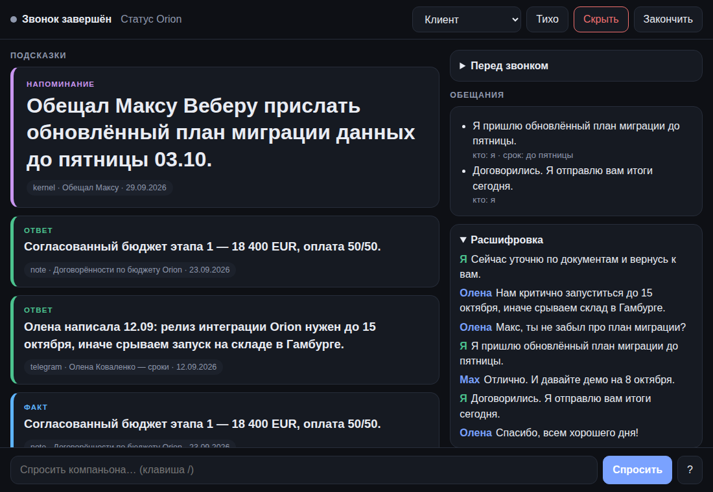

# Компаньон для созвонов

Слушает созвон, понимает, что сказано, достаёт из вашего **kernel** всё, что к этому относится, и тихо подсказывает на экране: что вы обещали, какая цифра согласована, кто это и что с ним было. После звонка делает итоги, список обещаний и черновик письма. В kernel что-либо записывается только после вашего «да».



> Скриншот сделан на вымышленных данных из `examples/`. Подсказки здесь строит детерминированная заглушка `FakeLLM`: она пересказывает найденный материал и ничего не «понимает». Качество живых подсказок определяет Claude, и на этом этапе его вживую не запускали (подробнее в разделе «Что проверено»).

## Как это работает

```
 MacBook Air M1                                                    ПК с kernel
┌─────────────────────────────────────────────────┐        ┌───────────────────────────┐
│ микрофон ──┐                                     │        │ чаты · заметки · календарь│
│            ├─► VAD ─► Whisper (MLX) ─► реплики   │        │ задачи · GitHub · …       │
│ звук ──────┘          «я» / «они»                │        │ (ваш код, остаётся там)   │
│ собеседников               │                     │        │                           │
│                            ▼                     │  HTTP  │ kernel/companion:         │
│ триггеры: вопрос · пауза · имя · обещание        │◄──────►│  search · brief · notes   │
│                            ▼                     │Tailscale│ export ─► pack.jsonl ─┐  │
│ поиск: досье перед звонком + kernel ─► Claude    │        └───────────────────────────┘
│                            ▼                     │          синхронизация файла    │
│ HUD: окно · вкладка · телефон                    │◄───────── (работает и при        ┘
└─────────────────────────────────────────────────┘            выключенном ПК)
```

Главные идеи:

- **Свои и чужие разделены с самого начала.** Микрофон это «я», системный звук это «они». Диаризация не нужна, чтобы понять, кто говорит.
- **Молчит, пока не нужно.** По умолчанию подсказка появляется, только если вас спросили и вы замялись на три секунды, или прозвучало имя, про которое в kernel есть что сказать. Нет материалов — нет подсказки.
- **Ничего не выдумывает.** Каждая подсказка ссылается на источник из kernel; нет данных — задаёт уточняющий вопрос или молчит.
- **Работает без ПК.** kernel выгружает на Mac файл-пакет контекста; живые запросы по сети только дополняют его.
- **Не делает ничего опасного сам.** Речь собеседников недоверенный вход. Любое действие выше «чтение» (запись в kernel, отправка) требует вашего клика в HUD, голосом подтвердить нельзя.

## Быстрый старт

```bash
git clone -b claude/smart-call-companion-4icjl5 https://github.com/dansichka/start
cd start/call-companion
uv venv && source .venv/bin/activate        # или python3.12 -m venv .venv
uv pip install -e ".[mac]"                  # не на Mac: -e ".[faster]"

# 1. Демо без микрофона и без ключей: вымышленный звонок целиком
callc replay examples/sample_call.jsonl --kernel examples/sample_kernel_pack.jsonl \
    --meeting examples/meeting.json --user Даня

# то же в HUD в реальном времени (откройте напечатанную ссылку)
callc replay examples/sample_call.jsonl --kernel examples/sample_kernel_pack.jsonl \
    --meeting examples/meeting.json --user Даня --ui --speed 1

# 2. Проверить, готов ли именно этот компьютер
callc doctor

# 3. Живой звонок
export ANTHROPIC_API_KEY=...
callc run --title "Созвон с Оленой" --attendee "Олена Коваленко:Acme" --window
```

Что поставить на Mac и какие дать разрешения: [docs/MACOS_SETUP.md](docs/MACOS_SETUP.md). Как подключить настоящий kernel: [docs/KERNEL_CONTRACT.md](docs/KERNEL_CONTRACT.md). Настройки: [examples/config.example.toml](examples/config.example.toml).

## Когда компаньон подсказывает

| Что произошло | Подсказка |
|---|---|
| Вам задали вопрос и вы молчите `hesitation_s` секунд | ответ из материалов kernel |
| Прозвучало имя, проект или компания, про которые есть материалы | напоминание, например что вы обещали человеку |
| Вы нажали «?» или спросили в HUD | подсказка по последней реплике или по вашему вопросу |
| Прозвучало обещание («я пришлю до пятницы»), ваше или чужое | подсказки нет, пункт молча попадает в «Обещания» |

Режим `live.assist`: `on_hesitation` (по умолчанию), `always` (отвечать на каждый адресованный вам вопрос сразу), `manual` (только по запросу). В групповом звонке вопрос считается адресованным вам, если в нём названо ваше имя (склонения подбираются сами).

Чтобы не мешать, действует ограничитель: не чаще одной подсказки в `min_gap_s`, не больше `max_whispers_per_min` в минуту, фоновые повторы подавляются. Прямой вопрос ограничитель не режет, пока не включён режим «Тихо».

## Режимы разговора и приватность

У каждого материала в kernel есть метка `public / work / private / secret`. Режим звонка задаёт потолок: `internal` до `private`, `client` и `interview` до `work`, `public` только `public`. `secret` не уходит из kernel никогда. Сервер kernel режет по метке сам, а компаньон проверяет ещё раз.

Из всего, что уходит в модель и на экран, вычищаются ключи, токены, пароли, номера карт и IBAN. Аудио не сохраняется. Расшифровка на диск попадает только при `privacy.store_transcripts = true`. Подробнее: [docs/PRIVACY.md](docs/PRIVACY.md).

## Что проверено

| Часть | Статус | Как проверено |
|---|---|---|
| Движок: триггеры, пауза, поиск, ограничитель, режимы | проверено | 300+ автотестов на виртуальных часах |
| Контракт kernel: HTTP, CLI, файл-пакет | проверено | настоящий клиент против настоящего сервера; сторона kernel на Python 3.10 |
| Запросы к Claude | форма запроса | реальный код SDK против подменённого транспорта; живых вызовов не было, ключа не было |
| HUD | проверено | настоящий Chromium: отрисовка, защита от XSS из речи, перезагрузка, телефон, тёмная тема |
| Безопасность HUD-сервера | проверено | токен, проверка Host (DNS-rebinding), заголовок и Origin для POST |
| Подтверждения и журнал | проверено | только HUD и CLI (слот для горячей клавиши зарезервирован, глобальных клавиш пока нет); журнал с цепочкой хэшей |
| VAD, фильтр «фантомных» фраз Whisper | проверено | синтетический звук |
| Захват звука (BlackHole через sounddevice) | логика | поддельный PortAudio; на устройстве не запускалось |
| Whisper на MLX | обёртка | сверено с исходниками mlx-whisper 0.4.3; на Mac не запускалось |
| Нативный помощник `audiotap` (Swift) | не компилировался | нет Swift-тулчейна; код написан по документации API |
| Плавающее окно macOS | не проверено | поддельные AppKit и pywebview |
| Подключение к вашему kernel | ждёт | реальный kernel был недоступен; контракт и серверный модуль готовы |

Задержку и качество распознавания на M1 Air можно узнать только на нём: `callc doctor` покажет, что готово, поле «latency» в HUD — сколько занимает подсказка.

## Структура

```
src/call_companion/
  live/        движок: транскрипт, триггеры, сущности, поиск, ограничитель, engine.py
  asr/         VAD, Whisper (mlx / faster), фильтр галлюцинаций, воспроизведение записей
  capture/     звук: sounddevice (BlackHole) и нативный audiotap
  kernel/      клиенты kernel: snapshot, http, cli, composite, memory
  kernel_api.py, kernel_server.py, redact.py   серверная половина контракта для стороны kernel
  llm/         промпты, разбор ответа, Claude, FakeLLM
  post/        итоги, хранение сессий, запись в kernel через подтверждение
  ui/          HUD (сервер + страница), консоль, окно macOS
  policy.py    уровни доступа, подтверждения, журнал; runner.py и cli.py — запуск
native/macos/AudioTap/   Swift-помощник захвата звука
examples/                вымышленный звонок, пакет kernel, конфиг
docs/                    архитектура, контракт kernel, macOS, приватность
```

## Разработка

```bash
uv pip install -e ".[dev]"
pytest                      # всё, кроме браузерных тестов, идёт без внешних сервисов
HUD_SCREENSHOTS=docs/img pytest tests/test_hud_browser.py   # заодно обновить скриншоты
```

Браузерные тесты используют Chromium из `/opt/pw-browsers` либо путь из `CHROMIUM_PATH` и пропускаются, если его нет. Демо-пакет пересоздаётся командой `python examples/make_demo_pack.py`.
